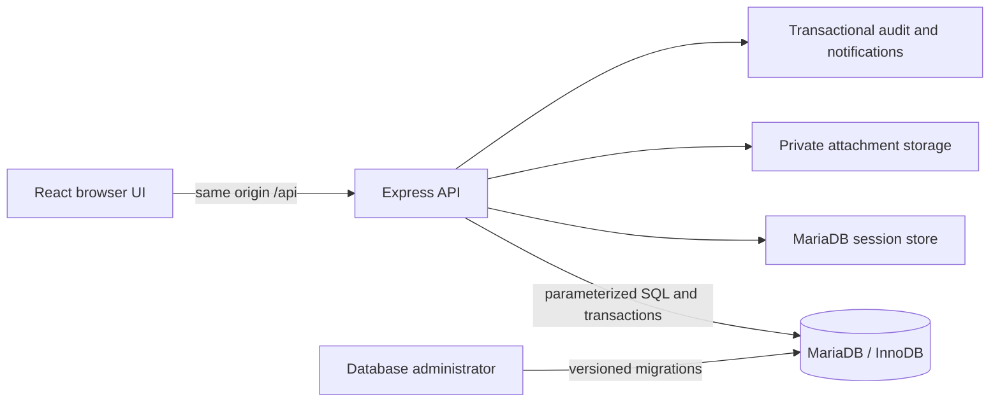
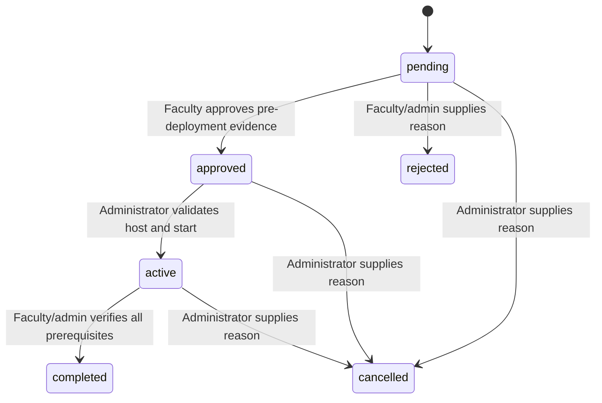

# Implemented system overview

This is a technical handover draft. The institution has not provided a thesis/report template or approval signatories. Adapt this document, the ERD, dictionary, manuals and captured screenshots to that required format; institutional acceptance is still pending.

## Problem and implemented behavior

Students, faculty and industry supervisors need a shared internship record. This application records assignments, versioned private requirements, planned schedules, actual duty and evaluations. Administrators manage prerequisites, faculty review assignments/documents and final grades, students submit their own work, and explicitly assigned company supervisors review company duty and author evaluations. Dashboard figures are computed from stored records.

## Architecture

Frontend routes use an authenticated role and server-sourced profile. Controllers validate HTTP shape, services enforce assignment/state/transaction rules, repositories own parameterized SQL, and shared helpers manage scope, audit, notifications, pagination and time. Frontend styles use local design tokens derived from DESIGN.md. Source remains outside Apache htdocs.

## Placement lifecycle

Each create/status operation locks student before placement and checks live conflicts. A generated unique live_student_id supplements that lock. Terminal history remains immutable; active transfers and finalized score revisions require a separately designed future workflow.

## Requirements, duty and completion

Requirements snapshot active templates and keep immutable file versions. Student submission becomes submitted, faculty/admin reviews approved/rejected, and an explicit reopen is required to replace approved evidence. Files stay outside public roots and use verified signatures, UUID storage keys, checksums and authenticated downloads.

Planned schedules award no credit. Actual logs derive the Manila work date and UTC instants from explicit +08:00 clocks. The server computes elapsed minutes minus breaks, checks overlap under a placement lock, and repeats daily cap checks at submit/approve. Only approved duty contributes to progress; reopening removes credit immediately. Independent child aggregation prevents a document/time join from multiplying hours.

Company supervisor or school faculty authors a single midterm and final scorecard. Highest active rubric version is copied as snapshots. Submission requires every score; faculty/admin finalizes. Percentage is 100 * sum(score) / sum(snapshot maximum), computed with bounded hundredths/DECIMAL. Students receive finalized results only.

Completion requires sufficient approved minutes, all required snapshot documents approved, both evaluations finalized and no submitted document/duty reviews. Completion locks and rechecks those prerequisites transactionally.

## Evidence and limitations

See implementation-state.md for actual check results, task-completion.md for each original checkbox, evidence/ for synthetic screenshots/metrics, test-plan.md for human UAT and deployment.md for recovery. Public hosting, real-person UAT, official academic policy, backup encryption/retention approval and the institution-specific report format are not represented as completed by source code or automated tests.
