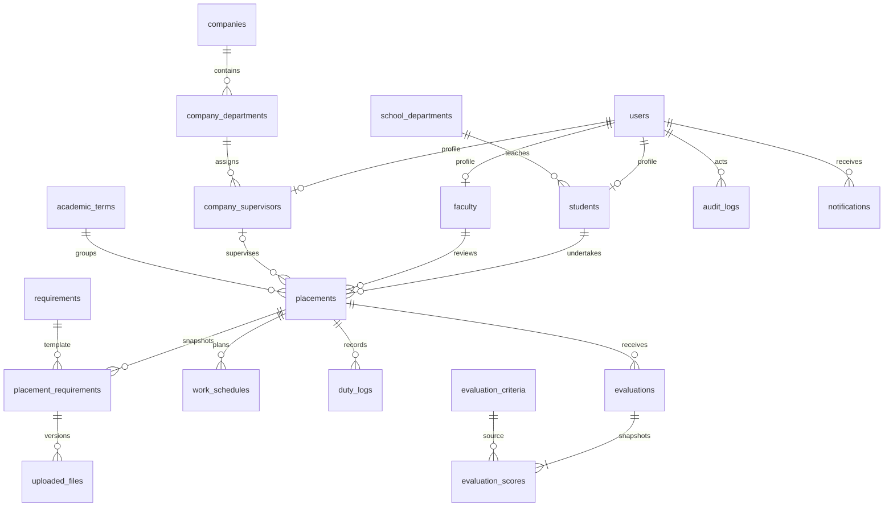

# Entity relationships

Foreign keys restrict historical deletion. Current upload is a nullable reverse reference added after both tables exist. Services verify ownership. Sessions use adapter-defined primary keys. Migrations include operational migration history and reserved hashed reset tokens.
