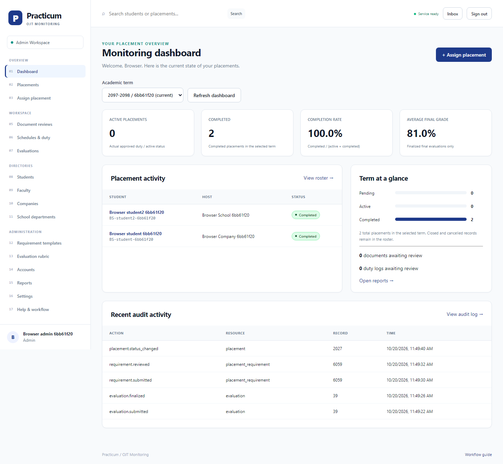
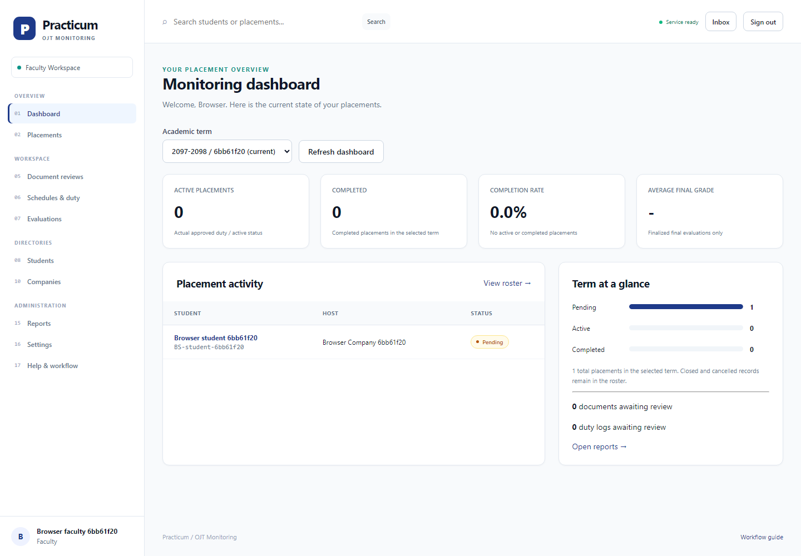
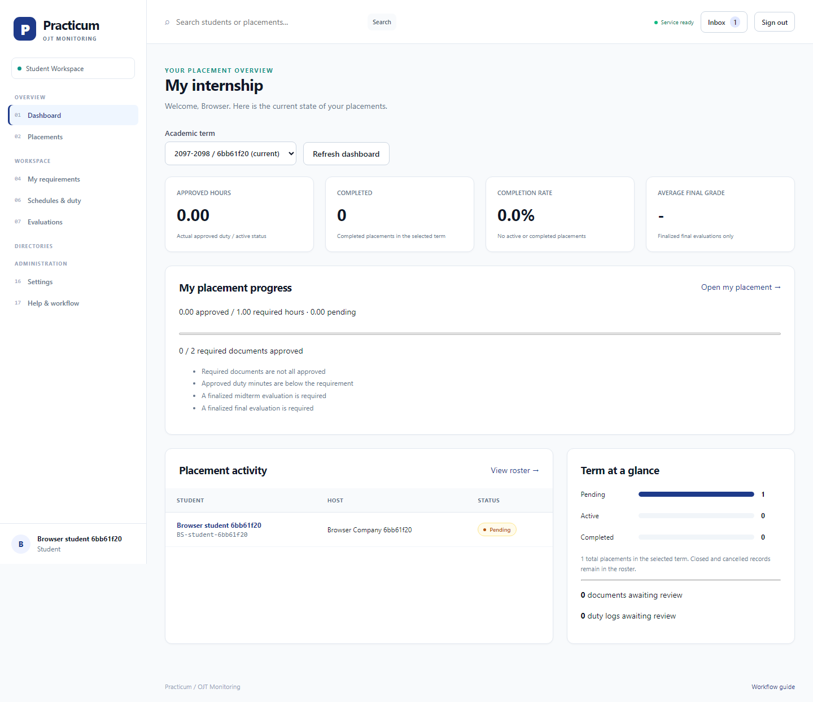
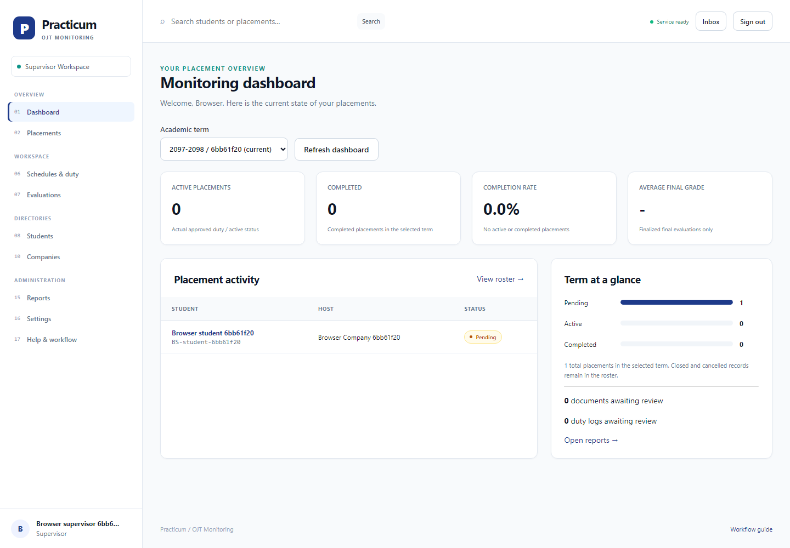
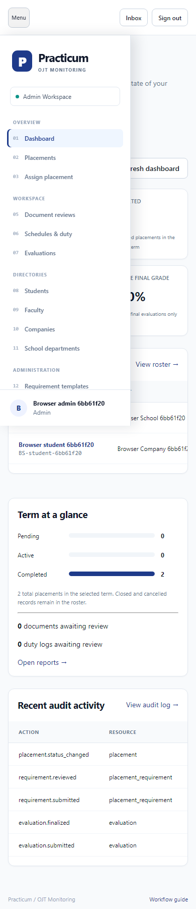

# Practicum user manual

All dates/times in the interface use Asia/Manila. New accounts receive a temporary password directly from the administrator. On first login, enter it as the current password, set a new password of 12-72 UTF-8 bytes, and sign in again. Settings allows changing your own name and password. For recovery, ask the administrator for an assisted reset. The system does not send email.

## Administrator

1. Open School departments and add the academic units. Open Settings and add academic terms with valid date ranges, then choose Make current. That term is the default for dashboards.
2. Open Companies, add a host, then Departments to create its operating units. Open Accounts and create faculty, company supervisor and student accounts. Fill in the role-specific institutional identifiers and department. Roles are fixed after creation. Duplicate identifiers are rejected.
3. Maintain Requirement templates and Evaluation rubric. Requirement templates use pre-deployment, ongoing and completion stages. A used rubric cannot be changed; publish a new numeric version. Archiving a directory/template preserves history.
4. Choose Assign placement. Select student and term, choose company/school host, assign faculty and an optional matching company supervisor, enter dates inside the term and required hours from approved program policy, then review and save. A student can have one pending/approved/active placement.
5. Faculty approves the placement after required pre-deployment files are approved. Activate it only after the start date with an active host/reviewer. A company placement requires its supervisor before activation. Cancellation requires a reason and preserves the record.
6. Use Reports to filter by term, status and student search. CSV and Print / Save PDF include all permitted matching pages. Review Audit log for actor/action/record/request evidence. Resetting a password or deactivating an account revokes its sessions. The last active administrator cannot be deactivated.

## Faculty

1. Dashboard and Placements show only assignments to you. Open a placement or Document reviews. Choose the relevant placement and download submitted document versions.
2. Approve valid documents or reject with a clear reason. Students can resubmit rejected requirements. Reopen an approved document with a reason before replacing it. The old file versions remain available.
3. Approve the pending placement once required pre-deployment documents are approved. An administrator activates it.
4. For school-hosted students, Schedules & duty lets you plan weekly schedules and review actual logs. Planned schedules give no duty credit. Reject with a reason; reopen approved duty when a correction is needed, which immediately removes its approved credit.
5. For company placements, the assigned supervisor authors evaluations. Review submitted midterm/final scorecards and choose Finalize. For school placements, you author, score, submit and finalize. Finalization publishes results and freezes the scorecard.
6. Open the placement overview to review blockers. Complete placement only when sufficient approved duty, every required document, both finalized evaluations and all submitted reviews are resolved.

## Student

1. Dashboard shows your live placement, or latest history if no live one remains. Required hours come from the recorded assignment. Approved and submitted/pending hours are separated.
2. My requirements lists copied templates. Upload a genuine PDF, JPEG or PNG with its matching extension, at most 10 MiB. Select Upload file, choose the document and submit. Status becomes submitted. Check remarks after review; replace a rejected file by submitting a new version.
3. In an active placement, use Schedules & duty / Log duty. Enter actual clock in/out in Manila time on the same date, plus break minutes. Only elapsed duty inside placement dates is accepted; overnight and overlapping duty is rejected. The initial maximum is 480 credited minutes per day.
4. Save a draft, check it, then Submit. Draft/rejected duty can be edited or deleted. Submitted and approved duty cannot be edited ordinarily. Your reviewer must reopen an approved log before correction. Only approved minutes count toward completion.
5. Evaluations shows finalized scorecards only. You cannot approve documents, duty or placement completion. Inbox notifications link to the relevant placement and refresh every 30 seconds.

## Company supervisor

1. Your dashboard/roster contains only interns explicitly assigned to you, even when another supervisor works in the same department.
2. In Schedules & duty choose an intern. Plan weekly work with start/end, break, weekday and effective date range. Review submitted actual duty separately; approve or reject with a reason. Reopen an approved log with a reason for corrections.
3. In Evaluations start midterm or final. Fill each rubric criterion within its shown maximum, save draft, then submit when complete. The displayed percentage is total score divided by total maximum. Faculty finalizes it. Finalized scores are read-only.
4. Use Reports for permitted placements and export with the displayed filters. Ask the administrator to correct assignments; transferring active historical placements is outside the initial release.

## Navigation and common feedback

On mobile, Menu opens navigation. Forms have explicit labels, visible keyboard focus and modal Escape/focus return. Loading states wait for real responses; empty states mean no permitted records. Use Try again after a connection error. Submission controls disable while a request is running; server conflicts remain the final duplicate protection.

A 403 means the action is unavailable to your role or requires a password change. An inaccessible detail may be shown as not found. A completion conflict includes readable blockers. Missing files require administrator recovery from the matching backup. Sign out after use; an old captured session cookie cannot be reused after logout.

## Institutional decisions still required

Program hours, requirement due dates, grading weights, retention and representative acceptance must be approved locally. This implementation makes no regulatory compliance claim and does not treat sample 486 hours as institutional policy. External email, overnight shifts, active-placement transfers, finalized-evaluation revisions and XLSX are outside this initial contract.
